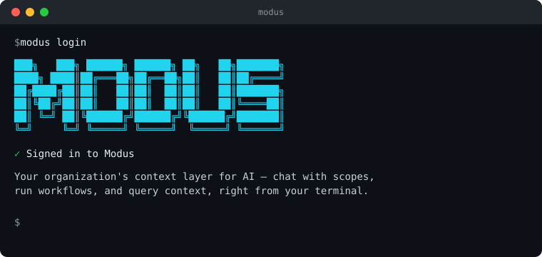

<p align="center">
  
</p>

<h1 align="center">Modus CLI</h1>

<p align="center">
  The official command-line client for <a href="https://getmodus.com">Modus</a> —
  chat with your scopes, manage workflows and context, and script against the
  Modus API from a terminal, a CI pipeline, or an agent.
</p>

<p align="center">
  <a href="https://www.npmjs.com/package/@getmodus/cli"></a>
  <a href="https://www.npmjs.com/package/@getmodus/cli"></a>
  <a href="https://opensource.org/licenses/MIT"></a>
</p>

<p align="center">
  
</p>

---

## Quick start

```bash
# npm
npm install -g @getmodus/cli   # the -g is required — without it, `modus` won't be on your PATH

modus login                  # opens your browser to sign in
modus scopes list --pretty   # confirm it worked
```

<details>
<summary><strong>Getting a permission error (EACCES)?</strong></summary>

Your npm install prefix isn't writable by your user — common when Node was
installed via an OS installer rather than a version manager. Point npm at a
directory you own instead of using `sudo`:

```bash
mkdir -p ~/.npm-global
npm config set prefix ~/.npm-global
echo 'export PATH="$HOME/.npm-global/bin:$PATH"' >> ~/.zshrc   # zsh — use ~/.bashrc if you're on bash
source ~/.zshrc                                                # or: source ~/.bashrc
npm install -g @getmodus/cli
```

</details>

## Authenticate

```bash
modus login              # browser-based OAuth (default) — interactive/local use
modus login --no-oauth   # PAT prompt instead — CI/scripts/headless
modus whoami             # confirm the resolved org/token/auth method
```

- **OAuth (default)** opens your browser and requests exactly the access your
  account already has in the Modus web app — nothing more, nothing held back.
  The access token refreshes automatically; `modus logout` revokes it
  server-side.
- **CI/scripts:** set `MODUS_API_KEY` — it always overrides the stored
  credential and is the preferred way to authenticate non-interactively.
- Avoid `modus login --token modus_pat_xxx` — a token on the command line is
  readable from shell history, `ps`, and CI logs.

### Staging (and other non-prod)

Point the CLI at staging with a staging PAT and `MODUS_BASE_URL`. Chat uses a
separate agent host; for Modus-owned `api.getmodus.com` /
`api.<env>.getmodus.com` origins the CLI/SDK derive `agent.*` automatically
(`api.staging…` → `agent.staging…`), so you only need one URL:

```bash
# Replace with your own staging PAT from the staging Modus app → Settings → API Tokens
export MODUS_API_KEY='modus_pat_xxx'
export MODUS_BASE_URL='https://api.staging.getmodus.com'

modus whoami --pretty
modus scopes list --pretty
modus scopes chat 42 "what can you do?"
```

Or persist via login:

```bash
modus login --no-oauth --base-url https://api.staging.getmodus.com
```

Escape hatch for custom origins: set `MODUS_AGENT_HOST` explicitly.

## Output

- Commands that return data print **compact JSON by default** — pipe it to
  `jq`, a script, or an agent.
- Pass `--pretty` for a human-readable table or summary instead.
- **Exception:** `chat` / `scopes chat` stream raw response text by default;
  pass `--json` on those two for structured SSE events instead.

```bash
modus scopes list             # {"items":[...],"nextPageToken":null}
modus scopes list --pretty    # aligned table
```

## Examples

```bash
# Chat with a scope (streams the response, then exits)
modus scopes chat 42 "What changed in revenue last week?"
modus scopes chat 42                        # same, but interactive

# Create a scope, then deploy it
modus scopes create --name "Revenue Analyst" --model claude-sonnet-5
modus scopes create --example > scope.json  # full config fixture: edit it first
modus scopes create --file scope.json
modus scopes deploy 42

# Preview, then apply a connection selection (`setConnectionPreferences` in selection.json)
modus scopes selection-ops apply 42 --validate-only --file selection.json
modus scopes selection-ops apply 42 --file selection.json

# Workflows
modus workflows list --pretty
modus workflows runs list 7
modus workflows runs get 7 3f2b8c1e-5d4a-4e7b-9c0d-2a6f1e8b7c90   # run ids are UUIDs, from `runs list`
modus workflows run 42 "Run the weekly digest now"

# Context
modus context items list --context-type saved_query
modus context items list --connection-id files --parent-uid "" --context-type file_folder_metadata
modus context items list --connection-id files --parent-uid db-a --parent-uid PUBLIC --context-type file_upload
modus context items move <uid> --destination-folder-uid <folderUid>
modus context items move <uid> --destination-folder-uid ""
modus context items access update <uid> --file access.json
modus context notes create "Q3 pricing" "We raised list price 8% in July."
modus context files upload ./report.pdf
modus context files upload ./docs --wait-until ready
modus context files upload ./docs --folder-path reports
modus context files upload-from-url https://example.com/report.pdf
modus context files get <uploadId>
modus context files list
modus context dashboards list --pretty
modus context dashboards create --example > dashboard.json   # edit it first
modus context dashboards create --file dashboard.json
modus context dashboards publish <dashboardId> --expected-revision 1
modus context dashboards elements list <dashboardId> --pretty
modus context dashboards layout update <dashboardId> --file layout.json

# Active runs
modus runs list-active --pretty
modus runs cancel <runId>
```

### Scope toolsets

Edit `toolset` in the JSON from `modus scopes create --example`, then pass it via
`--file` or `--body -` to create/update. Integration keys are catalog platform keys;
each grants actions on an explicit lowercase connection UUID:

```json
{
  "toolset": {
    "postgresql": {
      "byConnection": {
        "11111111-1111-4111-8111-111111111111": { "actions": ["query"] }
      }
    },
    "memory": { "enabled": true }
  }
}
```

Replace the UUID with your chosen PostgreSQL connection. Other SQL platforms use their
own platform key and the same `query` action. For other integrations, use operation IDs
from `modus tools list`, with optional slot `rules.allowedChannelIds` and
`rules.allowedChannelNames`. Grants stay separate per connection.

The API validates toolsets; the CLI does not translate or bind them. Flat `{ actions }`,
integration action arrays, `scope`/personal encodings, action suffixes and unknown keys
(including the retired `sql_runner`, `looker_bi`, `langfuse_observability` and `*_analytics`)
return 422, even when resending a stored value. General tools, MCP, Pipedream and Coding formats are unchanged.

### Example bodies

`--example` prints a starting body with a `PLACEHOLDER_*` value wherever an id from your org
belongs (`PLACEHOLDER_CONNECTION_ID`, `PLACEHOLDER_CONTEXT_ITEM_UID`, `PLACEHOLDER_SCOPE_ID`).
Replace each one, or delete the field, before you pass the file back: every `--file` and
`--body -` command refuses a body that still has a placeholder, and names where it is.
`modus connections list` and `modus context items list` give you the ids.

`access.json` for `context items access update` replaces all three settings:

```json
{
  "visibility": "private",
  "groupPermissions": {},
  "sharedWith": [{ "email": "ana@your-company.com", "permission": "use" }]
}
```

`layout.json` for `context dashboards layout update` moves or resizes tiles and filters on a
draft. `elementId` is a tile or filter `id` (`context dashboards elements list` shows them), and
the grid is 12 columns wide. `--expected-revision` overrides `expectedRevision`:

```json
{
  "expectedRevision": 1,
  "elements": [{ "elementId": "revenue-table", "layout": { "x": 0, "y": 0, "w": 12, "h": 4 } }]
}
```

The `dashboards create --example` body leaves positions out, so new tiles get default places;
set them afterwards with `layout update`.

## Features

- **Scopes** — chat, create, deploy, evaluations, memories, supervision, Slack
  and Microsoft Teams interfaces, MCP configuration, ownership transfer.
  `scopes update` replaces whole lists such as `connectionSet`, `contextSelections`,
  and `evaluations`. Change one evaluation case with `scopes evaluations cases`, and
  one connection's selection with `scopes selection-ops apply` (`--validate-only`
  previews and does not write). `selectRoot`, `deselectRoot`, and `setRootDeepRules`
  are deprecated.
- **Workflows** — create, trigger, run history, ownership transfer.
- **Context** — organization context items, notes, saved queries, file uploads,
  dashboards (drafts, publishing, version history, access, ownership transfer)
  and their tiles, filters and layout.
- **Connections, usage, and org members.**

## Commands

Run `modus --help` or `modus <topic> --help` (e.g. `modus scopes --help`) for
the full, current list — this README doesn't duplicate it since it drifts.

## Development

```bash
pnpm --filter @getmodus/cli run build
pnpm --filter @getmodus/cli exec vitest run
./bin/dev.js --help   # run from source (tsx), no build needed
```
